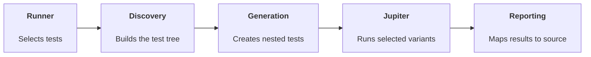

# JUnit Comparison Engine

Run the same JUnit Jupiter tests against multiple implementations of a contract. Give each implementation a named result in the test tree so you can see which one failed and rerun it directly.

Use the engine to compare a reference implementation with a replacement, test several backends, or check an optimized implementation against the same inputs and assertions.

## Quick start

You need JDK 21 and Maven 3.9 or later.

```sh
git clone https://github.com/IWillBurn/junit-comparison-engine.git
cd junit-comparison-engine
mvn clean verify
```

The multiplication example runs two input rows against the `GOOD` and `BUGGY` variants returned by `CalcSource`. [MulTest.java](examples/src/test/java/examples/MulTest.java) · [CalcSource.java](examples/src/test/java/examples/CalcSource.java)

```java
import static org.junit.jupiter.api.Assertions.assertEquals;

import org.atpfivt.comparison.api.ComparisonArguments;
import org.atpfivt.comparison.api.ComparisonTest;
import org.junit.jupiter.params.ParameterizedTest;
import org.junit.jupiter.params.provider.CsvSource;

@ComparisonTest(source = CalcSource.class)
class MulTest {
    @ParameterizedTest(quoteTextArguments = false)
    @ComparisonArguments(3)
    @CsvSource({ "2, 3, 6", "4, 5, 20" })
    void mul(int a, int b, int expected, Calc calc) {
        assertEquals(expected, calc.mul(a, b));
    }
}
```

Each input row has a separate result for each implementation. The example deliberately fails on the second row for `Buggy`, and the verification suite checks that failure.

```text
mul(int, int, int, Calc)
├── [1] 2, 3, 6
│   ├── Good  ✓
│   └── Buggy ✓
└── [2] 4, 5, 20
    ├── Good  ✓
    └── Buggy ✗ expected: <20> but was: <21>
```

You can also open the root `pom.xml` in IntelliJ IDEA and run `MulTest` from the gutter.

## Use in a Maven project

The current version is a source-built snapshot. Install it in your local Maven repository from the checkout.

```sh
mvn -pl engine -am install
```

Add the engine as a test dependency. Use the JUnit BOM to keep the Jupiter and Platform modules on **6.1.3**, the version used by this project.

```xml
<dependencyManagement>
    <dependencies>
        <dependency>
            <groupId>org.junit</groupId>
            <artifactId>junit-bom</artifactId>
            <version>6.1.3</version>
            <type>pom</type>
            <scope>import</scope>
        </dependency>
    </dependencies>
</dependencyManagement>

<dependencies>
    <dependency>
        <groupId>org.atpfivt.comparison</groupId>
        <artifactId>comparison-engine</artifactId>
        <version>0.1.0-SNAPSHOT</version>
        <scope>test</scope>
    </dependency>
</dependencies>
```

Place your comparison class under `src/test/java` and run `mvn test` with Maven Surefire. This project uses Surefire 3.5.4. The engine is discovered automatically on the test classpath.

## Supply variants and arguments

**`@ComparisonTest(source = MySource.class)`** runs the constants selected by `ComparisonSource<V>.variants()`. The source supplies Jupiter parameter resolvers for each selected variant. [ComparisonSource.java](engine/src/main/java/org/atpfivt/comparison/api/ComparisonSource.java)

Tests can receive the current enum constant as a parameter. Use `@Skip("BUGGY")` or `@Skip({"H2", "HANA"})` on a method to skip variants by their enum constant names.

A source can implement Jupiter `BeforeAllCallback` and `AfterAllCallback` for the comparison class, the class-template invocation callbacks for each invocation of a parameterized class, and `BeforeEachCallback` and `AfterEachCallback` for individual tests. Use the Jupiter store to own closeable resources. `ComparisonContext.classContext(context)` locates the store's owning class or class-template invocation from a test or its resolver.

For parameter order, resource lifetime, and extension behavior, see the [API and compatibility guide](API.md).

## How it works



The engine generates a subclass of the test class and delegates execution to Jupiter. Jupiter handles parameter sources, lifecycle callbacks, and extensions on the generated tests. The engine reports results against the original test methods so runners can navigate to the test and select individual implementations. Extensions that inspect test metadata can see the generated classes and methods.

## Contributing

The [`engine`](engine) module contains the API and the JUnit Platform engine. The [`examples`](examples) module demonstrates behavior, and [`verification`](verification) checks test trees, lifecycle, extension compatibility, and reruns through the Launcher API.

Run `mvn clean verify` before submitting a change. For a bug report, include the JDK and JUnit versions, the runner, and a minimal test that reproduces the behavior. [GitHub Issues](https://github.com/IWillBurn/junit-comparison-engine/issues)
